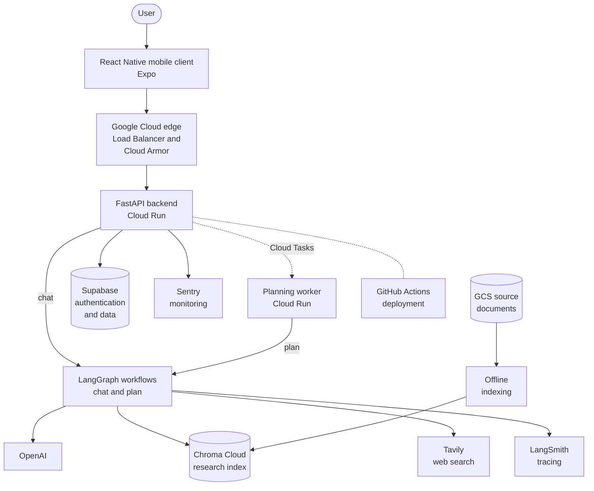
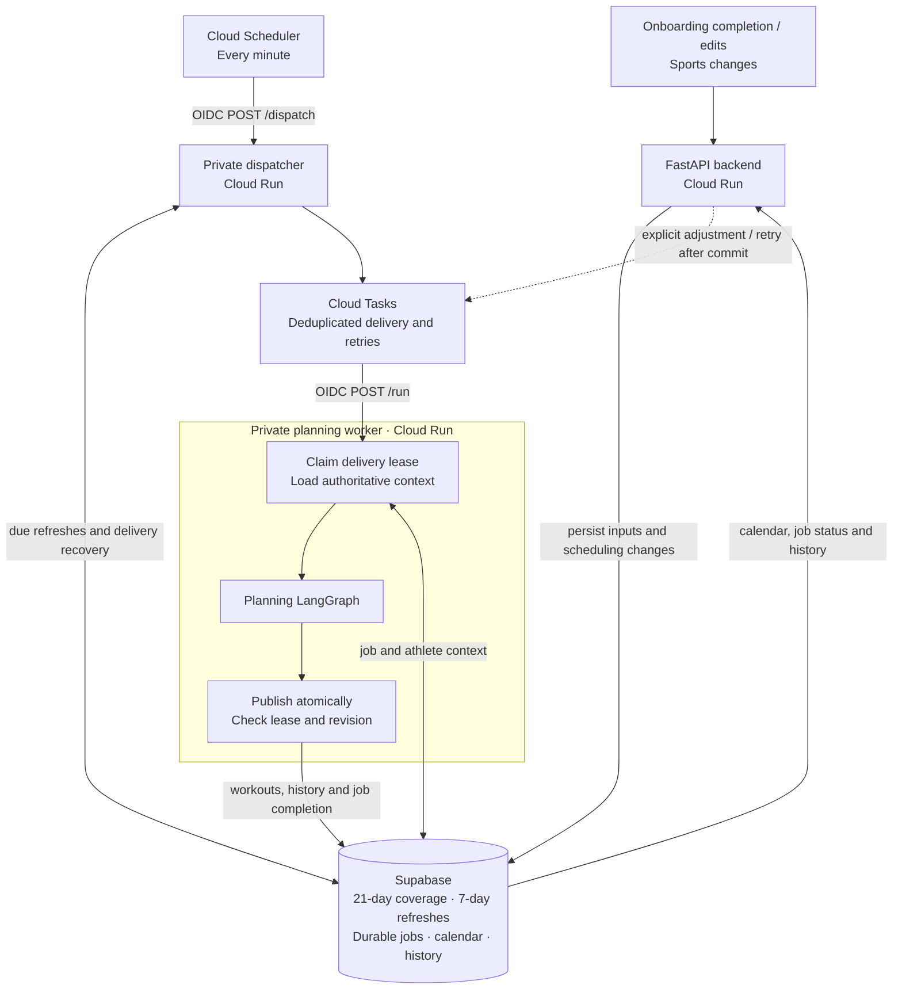
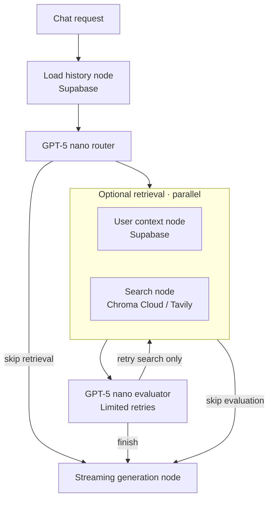
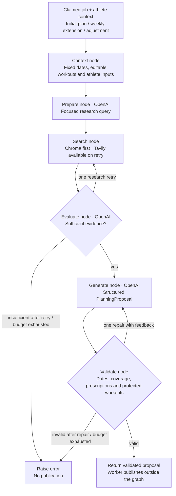
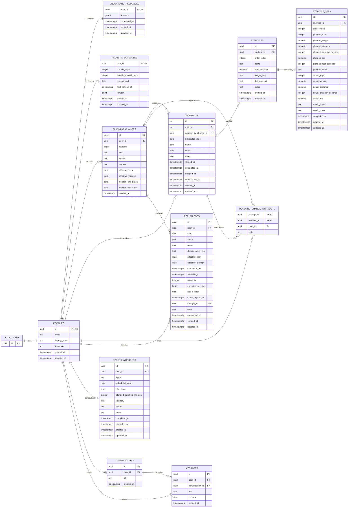

# Arcel: Strength & Conditioning Assistant

note: web client depreciated, mobile client currently in development

Arcel is a full-stack assistant for hybrid athletes building strength and conditioning programs around sport-specific demands. It answers conversational and research-backed training questions using more than 300 CC BY 4.0 research papers, live web search, and streamed LLM generation.

The Expo/React Native mobile client connects to the containerized FastAPI backend running on Google Cloud Run behind Google Cloud Load Balancing and Cloud Armor. The backend uses LangGraph for request-level workflow orchestration, deterministic evidence retrieval with bounded chat search retries, OpenAI for model inference, Chroma Cloud for research retrieval, Tavily for web search, and Supabase for authentication and application data. Cohere reranking and hybrid retrieval are available separately but are not part of the active chat workflow. GitHub Actions runs the tests before building and pushing backend images to Google Artifact Registry, deploying them to Cloud Run, and verifying backend health.

#### Table of Contents

- [Mobile App Demo](#mobile-app-demo)
- [App Infrastructure](#app-infrastructure)
- [Chat LangGraph Workflow](#chat-langgraph-workflow)
- [Workout Programming LangGraph Workflow](#workout-programming-langgraph-workflow)
- [Database Infrastructure](#database-infrastructure)
- [Local Development Services](#local-development-services)

---

#### Mobile App Demo

https://github.com/user-attachments/assets/b91a3d4c-24e4-497a-b0c3-b5eb1353975a

#### App Infrastructure

##### Programming Infrastructure

#### Chat LangGraph Workflow

#### Workout Programming LangGraph Workflow

#### Database Infrastructure

---

### Local development services

build api image from /
>> docker build -f server/Dockerfile -t arcel-backend .

run api server from /
>> docker compose up --build api

reindex with compose service
>> docker compose run --rm index

run mobile client from /mobile
>> npm start

build and install offline app using xcode from /mobile

>> npx expo run:ios --configuration Release --device

run web client from /client

>> npm run dev
