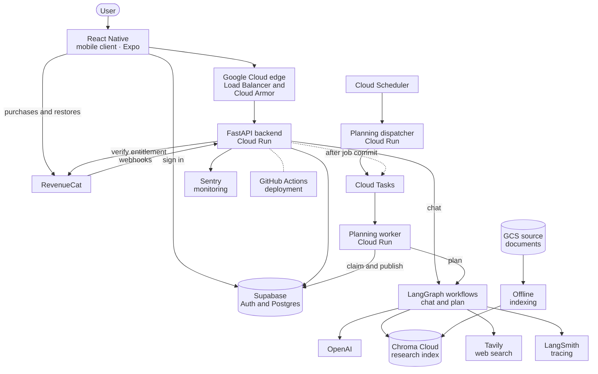
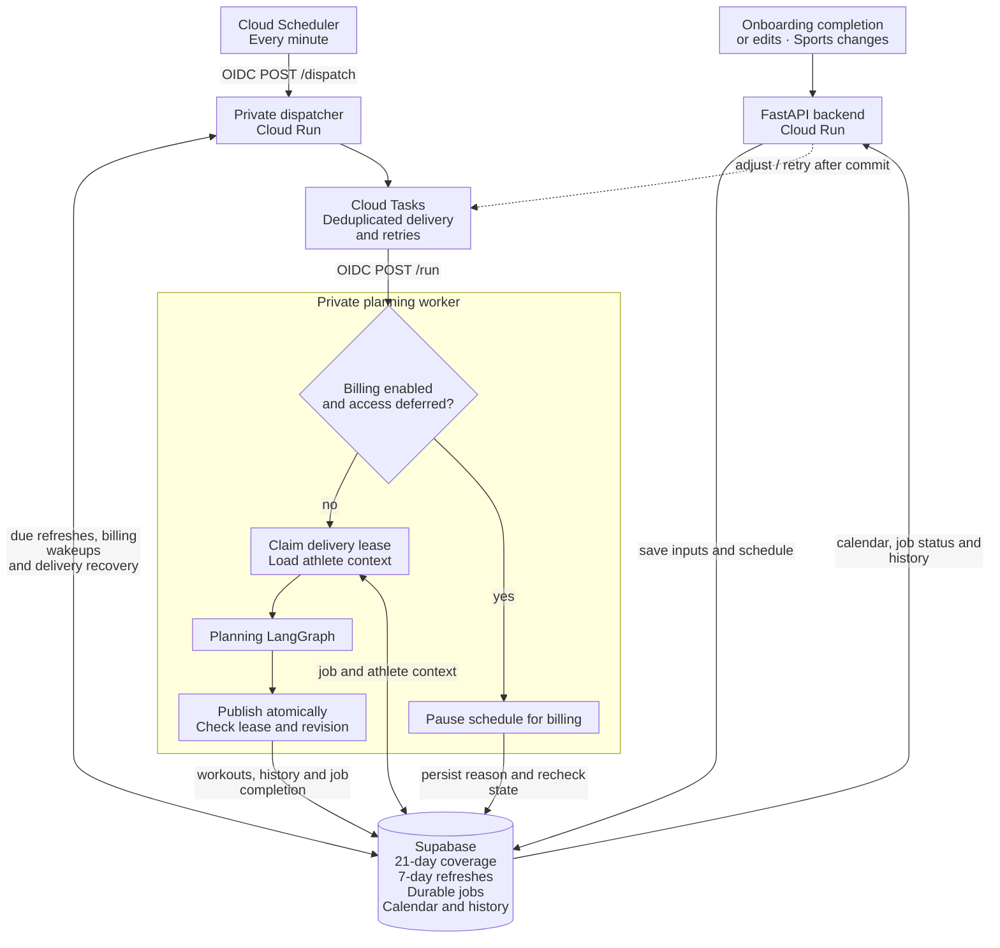
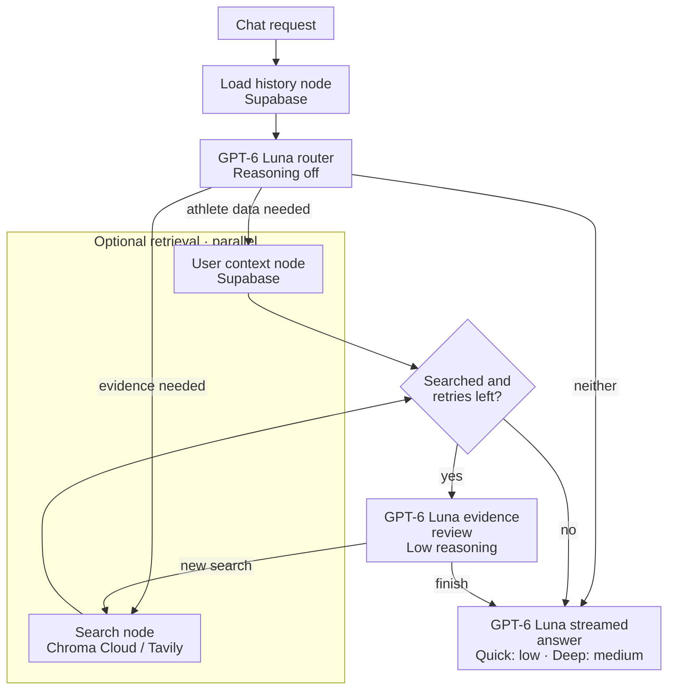
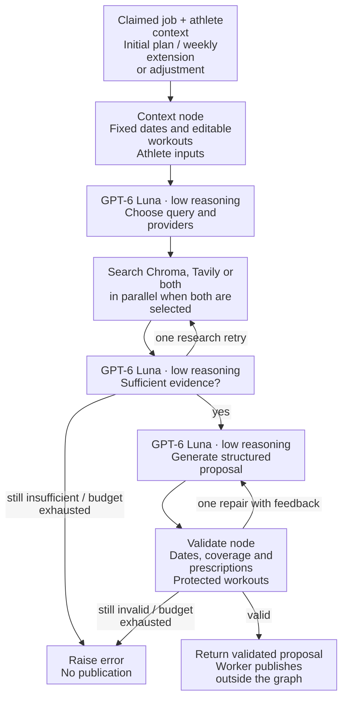
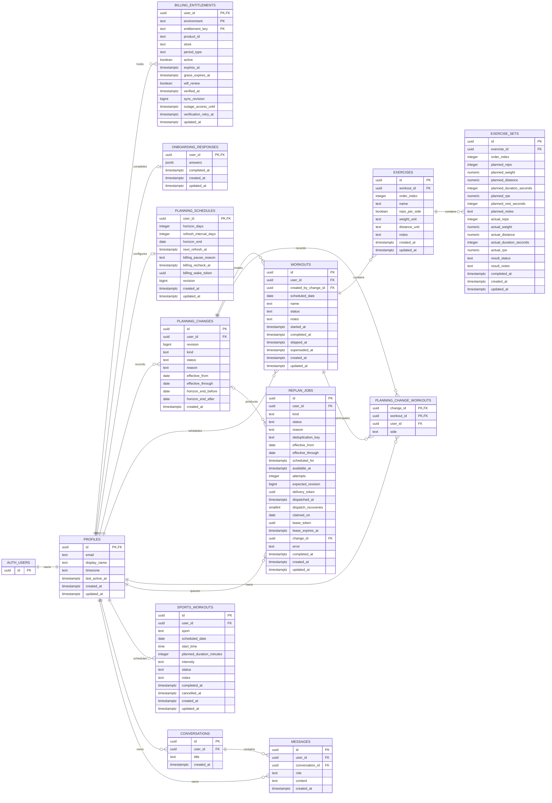

# Arcel: Strength & Conditioning Assistant

note: web client depreciated, mobile client currently in development

Arcel is a full-stack assistant for hybrid athletes building strength and conditioning programs around sport-specific demands. It answers conversational and research-backed training questions using more than 300 CC BY 4.0 research papers, live web search, and streamed LLM generation.

Adaptive workout programming turns onboarding responses, existing workouts, and scheduled sports sessions into a three-week training plan with exercise- and set-level prescriptions. Completing onboarding triggers the initial plan, and weekly refreshes extend its coverage. Changes to onboarding responses or sports commitments adjust upcoming workouts within the existing horizon while preserving completed training. The mobile Plan Manager shows the current plan, background job status, and a history of published changes.

The Expo/React Native mobile client connects to the containerized FastAPI backend running on Google Cloud Run. LangGraph orchestrates separate chat and planning workflows, using OpenAI for model inference, Chroma Cloud for research retrieval, Tavily for web search, and Supabase for authentication and application data. Chat uses deterministic evidence retrieval with bounded search retries; planning evaluates evidence, generates structured workouts, and validates proposed changes before publishing them atomically. Cloud Scheduler discovers due refreshes, and Cloud Tasks delivers durable jobs to a private Cloud Run planning worker so generation can finish independently of the mobile connection. Research retrieval combines dense similarity and BM25 keyword results through reciprocal rank fusion. GitHub Actions runs the tests before building and pushing backend images to Google Artifact Registry, deploying them to Cloud Run, and verifying backend health.

#### Table of Contents

- [Mobile App Demo](#mobile-app-demo)
- [App Infrastructure](#app-infrastructure)
- [Workout Programming Infrastructure](#workout-programming-infrastructure)
- [Chat LangGraph Workflow](#chat-langgraph-workflow)
- [Workout Programming LangGraph Workflow](#workout-programming-langgraph-workflow)
- [Database Infrastructure](#database-infrastructure)
- [Local Development Services](#local-development-services)
- [Mobile setup](mobile/README.md)
- [RevenueCat billing setup](docs/REVENUECAT.md)

---

#### Mobile App Demo

https://github.com/user-attachments/assets/b91a3d4c-24e4-497a-b0c3-b5eb1353975a

#### App Infrastructure

##### Workout Programming Infrastructure

#### Chat LangGraph Workflow

#### Workout Programming LangGraph Workflow

#### Database Infrastructure

---

### Local development services

build api image from /
>> docker build -f server/Dockerfile -t arcel-backend .

run api server from /
>> docker compose up --build api

replace the research index from /
>> docker compose run --build --rm index

install mobile dependencies from /mobile
>> npm ci

run mobile dev client from /mobile
>> npx expo start --dev-client --port 8081

build and install ios release on a device from /mobile
>> npx expo run:ios --configuration Release --device

run web client from /client
>> npm run dev
